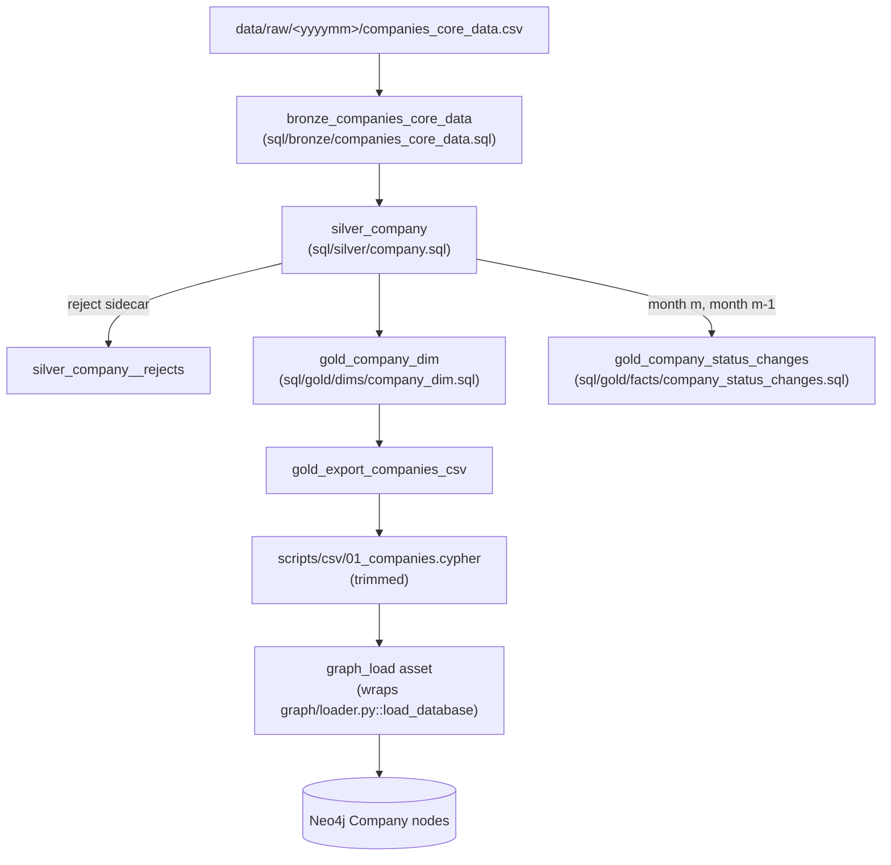

# Medallion Architecture Design

**Spec**: `.specs/features/medallion-architecture/spec.md`
**Status**: Approved

---

## Architecture Overview

A new DuckDB+Dagster layer sits between the existing raw CSV landing zone and the existing Neo4j graph load. Increment 1 implements exactly one vertical slice (`companies_core_data`) end-to-end; the pattern then repeats per table in Increment 2.



---

## Code Reuse Analysis

### Existing Components to Leverage

| Component | Location | How to Use |
| --- | --- | --- |
| `Settings`/`SETTINGS` | `src/nz_companies_office/config.py` | Extend with `bronze_dir`/`silver_dir`/`gold_dir` path properties, same `field(default_factory=...)` pattern already used for `raw_data_dir`/`linz_cache_dir` |
| `load_database()` / `load_csv()` | `src/nz_companies_office/graph/loader.py` | Unchanged signature; `graph_load` Dagster asset calls it directly after the export step, same function `just load-db` already uses |
| `scripts/csv/01_companies.cypher` | `scripts/csv/01_companies.cypher` | Trimmed, not replaced — keep `LOAD CSV WITH HEADERS`/`MERGE` structure |
| `docker-compose.yml` bind mount pattern | `docker-compose.yml:21` | Change the default path only, keep the mount mechanism |
| pytest fixture style (`tmp_path`, inline CSV writer) | `tests/test_csv_loader.py::_write_csv` | Same style for bronze/silver/gold fixture tests — small, realistic inline fixtures, not large fixture files |
| Exception hierarchy | `src/nz_companies_office/exceptions.py` | New orchestration errors (if any) subclass `CompaniesOfficeError`, consistent with `Neo4jConnectionError` etc. |

### Integration Points

| System | Integration Method |
| --- | --- |
| Neo4j / `docker-compose.yml` | Bind-mount default path changes from `./data/raw/202606` to `./data/gold/_neo4j_export/latest`; mechanism (volume mount + `LOAD CSV`) is unchanged |
| `just` / CLI | New `just dagster-dev` / `just pipeline <month>` recipes alongside (not replacing) existing `just load-db`/`er`/`enrich` |
| `pyproject.toml` | Add `dagster`, `dagster-webserver`, `dagster-duckdb`, `duckdb`; remove unused `dvc` |

---

## Components

### `orchestration.resources.DuckDBResource`

- **Purpose**: Provide a DuckDB connection to asset bodies without a persistent `.duckdb` file (reads/writes Parquet paths directly).
- **Location**: `src/nz_companies_office/orchestration/resources.py`
- **Interfaces**:
  - `get_connection() -> duckdb.DuckDBPyConnection` — via `dagster_duckdb.DuckDBResource`, no hand-rolled connection management
- **Dependencies**: `dagster-duckdb`, `duckdb`
- **Reuses**: N/A (new infra), follows `config.py`'s settings-object pattern for path resolution

### `orchestration.partitions.snapshot_month_partitions`

- **Purpose**: A static Dagster `PartitionsDefinition` derived from the real, readable `data/raw/<yyyymm>/` directories on disk.
- **Location**: `src/nz_companies_office/orchestration/partitions.py`
- **Interfaces**:
  - `snapshot_month_partitions: StaticPartitionsDefinition` — module-level constant, built from `sorted(p.name for p in SETTINGS.raw_data_dir.iterdir() if p.is_dir() and p.name.isdigit() and os.access(p, os.R_OK))`
- **Dependencies**: `config.SETTINGS`
- **Reuses**: `config.py::Settings.raw_data_dir` — must explicitly skip unreadable dirs (handles the orphaned `202606` case from `CONCERNS.md`/`STATE.md` B-001) and non-numeric names

### `orchestration.assets.bronze.bronze_companies_core_data`

- **Purpose**: 1:1 schema-preserving copy of one source CSV into partitioned Parquet.
- **Location**: `src/nz_companies_office/orchestration/assets/bronze.py`
- **Interfaces**:
  - `@asset(partitions_def=snapshot_month_partitions, group_name="bronze")` function, no return value (writes Parquet as a side effect, declared via `io_manager` or explicit `COPY ... TO`)
- **Dependencies**: `DuckDBResource`, `sql/bronze/companies_core_data.sql`
- **Reuses**: none (first bronze asset)

### `orchestration.assets.silver.silver_company`

- **Purpose**: Typed, renamed, validated, deduped `company` entity for one snapshot month.
- **Location**: `src/nz_companies_office/orchestration/assets/silver.py`
- **Interfaces**: `@asset(partitions_def=snapshot_month_partitions, group_name="silver", deps=[bronze_companies_core_data])`
- **Dependencies**: `DuckDBResource`, `sql/silver/company.sql`
- **Reuses**: none (first silver asset); establishes the pattern (main output + `_rejects` sidecar) that Increment 2 repeats

### `orchestration.assets.gold.gold_company_dim`, `gold_company_status_changes`, `gold_export_companies_csv`

- **Purpose**: Current-state dimension, SCD2 change-fact, and flat-CSV export for Neo4j load, respectively.
- **Location**: `src/nz_companies_office/orchestration/assets/gold.py`
- **Interfaces**: `gold_company_dim` unpartitioned (`@asset(group_name="gold_dims", deps=[silver_company])`, reads all silver partitions); `gold_company_status_changes` partitioned (`@asset(partitions_def=snapshot_month_partitions, group_name="gold_facts")`, reads current + previous silver partition inside the function body — no custom `PartitionMapping`); `gold_export_companies_csv` unpartitioned, depends on `gold_company_dim`.
- **Dependencies**: `DuckDBResource`, `sql/gold/dims/company_dim.sql`, `sql/gold/facts/company_status_changes.sql`
- **Reuses**: `silver_company`'s output schema

### `orchestration.assets.graph.graph_load`

- **Purpose**: Thin Dagster wrapper around the existing `load_database()`.
- **Location**: `src/nz_companies_office/orchestration/assets/graph.py`
- **Interfaces**: `@asset(group_name="graph", deps=[gold_export_companies_csv])`, calls `graph.loader.load_database(root_dir=...)`
- **Dependencies**: `graph.loader.load_database`
- **Reuses**: `graph/loader.py::load_database()` entirely unchanged

---

## Data Models

### `silver.company` (Parquet schema)

```
nzbn            VARCHAR   -- 13-digit, validated
company_number  VARCHAR
entity_name     VARCHAR
entity_type     VARCHAR
entity_status   VARCHAR
incorporation_date DATE  -- nullable
removal_date       DATE  -- nullable
snapshot_month  VARCHAR  -- 'yyyymm', also the partition key
```

**Relationships**: One row per `(nzbn, snapshot_month)`; `gold.company_dim` keys on `nzbn` only (latest `snapshot_month` wins); `gold.company_status_changes` keys on `(nzbn, snapshot_month)` where `snapshot_month` is the month the change was *detected in*.

### `gold.company_status_changes` (Parquet schema)

```
nzbn                VARCHAR
snapshot_month      VARCHAR  -- partition key, month of detection
previous_status     VARCHAR
new_status          VARCHAR
previous_snapshot_month VARCHAR
detected_at          TIMESTAMP
```

### `silver.company__rejects` (sidecar)

```
nzbn_raw        VARCHAR  -- the invalid, unparsed value
company_number  VARCHAR
snapshot_month  VARCHAR
reject_reason   VARCHAR  -- e.g. 'invalid_nzbn_format'
```

---

## Error Handling Strategy

| Error Scenario | Handling | User Impact |
| --- | --- | --- |
| Invalid NZBN format | Routed to `_rejects` sidecar, not dropped (MED-07) | None if under threshold; `@asset_check` failure surfaces in Dagster UI if over 0.1% (MED-08) |
| `data/raw/<yyyymm>/` unreadable (e.g. orphaned `202606`) | `partitions.py` filters it out at discovery time | That month simply isn't a selectable partition — no crash |
| `graph_load` run with Neo4j/Docker not up | `load_database()`'s existing `Neo4jConnectionError` propagates unchanged | Same failure mode as today's `just load-db` |
| Earliest partition has no "previous month" for SCD2 | `gold_company_status_changes` SQL `LEFT JOIN`/guard returns zero rows, not an error | Empty fact table for the first month, as specified in spec.md Edge Cases |

---

## Tech Decisions (only non-obvious ones)

| Decision | Choice | Rationale |
| --- | --- | --- |
| Partition type | `StaticPartitionsDefinition` globbed from disk, not `MonthlyPartitionsDefinition` | Raw dirs are fixed historical snapshots, not a guaranteed rolling calendar window |
| SCD2 partition dependency | Read current + previous partition explicitly inside the asset body | Simpler and more correct than Dagster's `PartitionMapping` API for this non-time-window case |
| Validation tool | Dagster `@asset_check`, not pandera/dbt-tests | Already adopting Dagster; native, typed, no second config surface |
| SQL parameterization | DuckDB named params (`$month`), not Python `.format()` | Safety + keeps `.sqlfluff` linting usable |
| Neo4j load source | Gold → flat CSV export (not `LOAD CSV` from Parquet) | Neo4j's `LOAD CSV` can't read Parquet without a bigger APOC rewrite; CSV re-export is one cheap extra asset |
| `DAGSTER_HOME` | In-repo `.dagster/`, gitignored | Default `~/.dagster_home` is outside the repo, not reproducible across machines/CI |
| Reading a single partition's Parquet file | Always pass `hive_partitioning = false` to `read_parquet()` when the path is one specific file | DuckDB auto-detects `key=value` path segments (e.g. `snapshot_month=202611`) and injects an extra column inferred as `BIGINT` — discovered while testing the bronze asset. This would silently collide with the explicit, string-typed `snapshot_month` column silver/gold add deliberately. Only enable hive partitioning for intentional multi-month globs (e.g. gold dims reading all silver history at once) |
| `AssetExecutionContext` + `from __future__ import annotations` | Asset modules do NOT use `from __future__ import annotations`, unlike the rest of the codebase | Dagster 1.13's `@asset` decorator validates the `context` parameter's type hint and does not resolve PEP 563 postponed (string) annotations for it — with the future import, asset functions fail at import time with `Cannot annotate context parameter with type AssetExecutionContext`. Discovered while implementing the first bronze asset; applies to every `orchestration/assets/*.py` module |
| `@asset_check` context parameter type | `AssetCheckExecutionContext`, not `AssetExecutionContext` | Caught live-materializing for the first time: `AssetExecutionContext` is only valid on `@asset`-decorated functions; `@asset_check` functions need `AssetCheckExecutionContext` (it has the same `.partition_key` API) or Dagster raises `DagsterInvalidDefinitionError` at runtime. Unit tests that call the pure helper function directly don't catch this — only a real Dagster materialization run does |
| Gold export directory | Keyed per snapshot month (`data/gold/_neo4j_export/<month>/`), not a reused `latest/` | The official Neo4j Docker image's entrypoint recursively chowns any bind mount placed under `$NEO4J_HOME` to its internal user on every container start (see STATE.md L-002), making a reused directory unwritable from the host after the first load. A fresh per-month directory sidesteps this |
| Neo4j import mount point | `/import/companies`, not `/var/lib/neo4j/import/companies` | `/import` is the official image's dedicated external-mount convention and is only read, never chowned — confirmed by reading the image's `docker-entrypoint.sh`. This is also the root cause of the pre-existing orphaned `data/raw/202606` directory (B-001), now understood |
| `NZ_CO_DATA_DIR` default in `docker-compose.yml` | No default (was `./data/raw/202606`) | A stale hardcoded month default is exactly what produced the B-001 orphan in the first place; failing fast when unset is safer than silently mounting the wrong/stale path |
| `hydra-core` dependency | Removed | Unused anywhere in the repo (confirmed by grep) and its `antlr4-python3-runtime<4.10` pin was blocking `dagster`'s CLI asset-selection DSL, which needs `>=4.13` (see STATE.md L-003) |
| 13 not-yet-migrated raw CSVs (directors, shareholders, addresses, etc.) | Copied through unchanged into the gold export dir alongside the gold-derived `companies_core_data.csv` | `scripts/csv/02..11*.cypher` still read them directly; without this passthrough, repointing the Docker mount at the gold export dir would break every load step except `01_companies.cypher` until Increment 2 migrates the rest |

---

## Tips applied

- Reused `config.py`'s settings pattern rather than inventing a new config mechanism.
- Reused the existing `load_database()` function rather than duplicating Neo4j-load logic in Dagster.
- `CONCERNS.md` B-001 (orphaned `202606` dir) is explicitly addressed in the partition-discovery design above.
